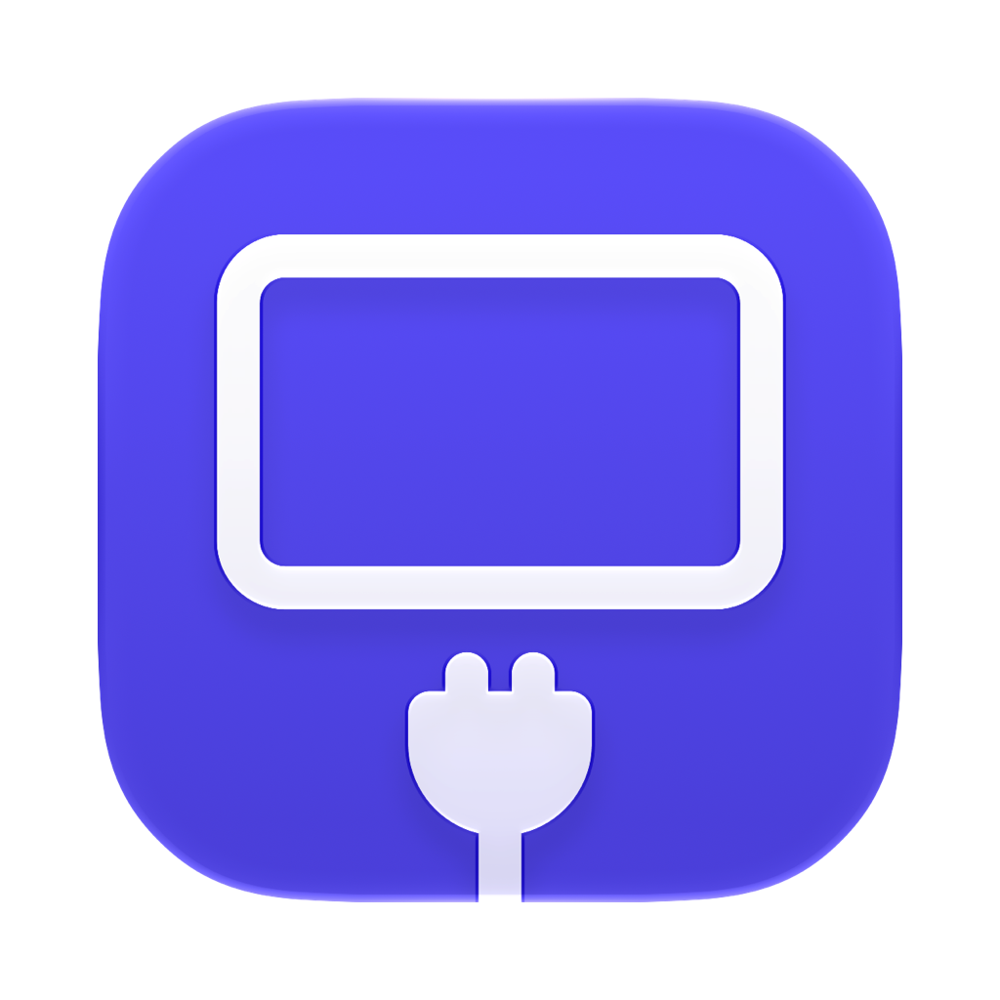
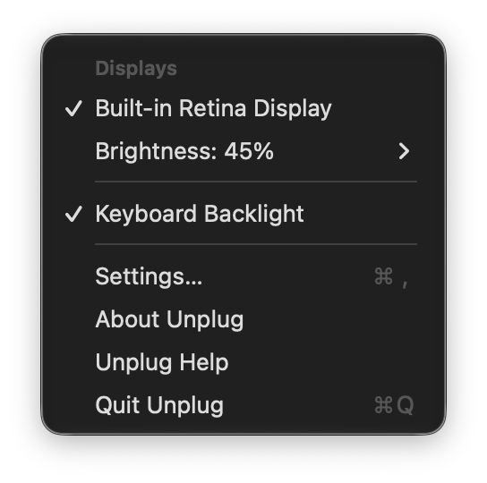
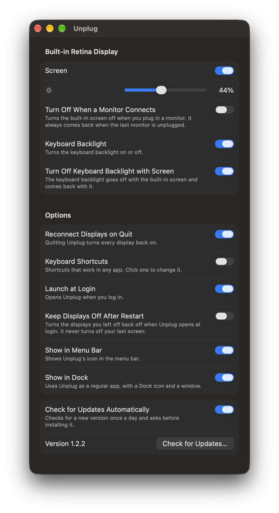

<p align="center">
  
</p>

<h1 align="center">Unplug</h1>

<p align="center">Disconnect a display on your Mac without pulling the cable.</p>

Unplug makes macOS forget a display, as if you unplugged it, and brings it back with one click. The cable stays in, so the monitor can keep charging your laptop and powering its USB hub while its screen is off.

It's free, open source (MIT) and runs on macOS 14 or later.

<p align="center">
  
  
</p>

## Install

1. Download `Unplug-<version>.dmg` from [Releases](../../releases/latest).
2. Open it and drag Unplug into Applications.
3. Open Unplug. macOS will warn that it can't check the app, because Unplug isn't notarized by Apple. Go to **System Settings > Privacy & Security**, scroll down and click **Open Anyway**.

You only need step 3 once. After that, Unplug updates itself.

## Use it

Click the display icon in the menu bar:

- **Turn a display off or on** by clicking its name.
- **Brightness:** drag the slider under each display, in the menu or in Settings. Works for the built-in screen, Apple displays, and most other monitors (through DDC on Apple Silicon Macs).
- **Linked brightness:** turn on Link Brightness for two or more displays in Settings > Displays, and one slider in the menu sets them all.
- **Keyboard Backlight:** on a MacBook, turn it on or off.
- **Reconnect All Displays** brings everything back.
- **Settings…** (⌘,) has every option, each with a short description:
  - **Displays:** brightness sliders, Link Brightness, "Turn Off When a Monitor Connects" (the built-in screen always comes back when the last monitor is unplugged), and the keyboard backlight going off with the screen.
  - **General:** launch at login, "Keep Displays Off" (after a restart and when a monitor is plugged back in), updates, and "Show in Dock" if you'd rather use Unplug as a regular app with a window. Control-click its Dock icon to turn displays off or on.
  - **Shortcuts:** change or turn off the keyboard shortcuts.
- **Unplug Help** opens the help in macOS's help viewer, which you can also search from the Help menu.

Keyboard shortcuts work anywhere. These are the defaults, and you can change them in Settings > Shortcuts:

| Shortcut | Does |
| --- | --- |
| ⌃⌥⌘U | Reconnect every display |
| ⌃⌥⌘B | Turn the built-in screen off or on |

## If something goes wrong

- Press **⌃⌥⌘U**, or quit Unplug. Quitting reconnects every display.
- Logging out or restarting always brings every display back, unless you turned on "Keep Displays Off".
- Unplug won't turn off your last working display.
- If you unplug a display while it's turned off in Unplug, choose **Forget** under it in the menu.

## Command line

The `unplug` command comes inside the app. To use it from Terminal, link it once:

```sh
sudo ln -sf /Applications/Unplug.app/Contents/Helpers/unplug /usr/local/bin/unplug
```

Then:

```sh
unplug list                  # show displays
unplug disconnect "LG"       # by part of the name, ID or UUID
unplug connect "LG"
unplug toggle 3
unplug connect --all
unplug brightness "LG" 70    # set brightness in percent; linked displays follow (leave out the number to read it)
unplug keyboard off          # keyboard backlight: on, off or toggle
unplug help                  # everything else
```

The command line and the app share their state, so you can turn a display off in one and back on in the other.

To use Unplug from the Shortcuts app, add a **Run Shell Script** action with, for example, `/Applications/Unplug.app/Contents/Helpers/unplug disconnect "LG"`.

## How it works

Apple has no public way to disconnect a display. Unplug uses one private macOS call, `CGSConfigureDisplayEnabled`, the same one other display tools use. It lives in a single small file, [`SkyLight.swift`](Sources/UnplugCore/SkyLight.swift), so it's easy to check. Everything else uses Apple's documented [Quartz Display Services](https://developer.apple.com/documentation/coregraphics/quartz-display-services). Changes only last until you log out.

Unplug does nothing in the background. It wakes up only when macOS reports a display change, when you open the menu or press a shortcut, and to check for updates when it opens and once a day.

The keyboard backlight uses another private call, from CoreBrightness, kept in [`KeyboardBacklight.swift`](Sources/UnplugCore/KeyboardBacklight.swift). Brightness uses Apple's private DisplayServices framework for the built-in screen and Apple displays, and the standard DDC/CI protocol for other monitors, all in [`Brightness.swift`](Sources/UnplugCore/Brightness.swift). Brightness is read only when you open the menu or the window.

## For developers

```sh
./scripts/build-dmg.sh   # builds build/Unplug.app and the .dmg
swift test               # runs the tests
```

Unplug logs what it does to the built-in screen, and any display change macOS rejects. To see the last 10 minutes:

```sh
log show --last 10m --predicate 'subsystem == "io.github.mihaiflorinpopa.unplug"'
```

To release, change the version in [`VERSION`](VERSION) and merge to main. CI publishes the GitHub release with the .dmg and the update feed (`appcast.xml`). Updates are checked with [Sparkle](https://sparkle-project.org). The .dmg and the update feed are both signed with the key in the `SPARKLE_PRIVATE_KEY` secret of the `release` environment, which only `main` can use, and the app accepts neither unless the signature matches. Its public half is [`Resources/sparkle-public-key.txt`](Resources/sparkle-public-key.txt).

## Author

Made by Mihai Florin Popa ([@mihaiflorinpopa](https://github.com/mihaiflorinpopa)).

## Related projects

- [BetterDisplay](https://github.com/waydabber/BetterDisplay) and [Lunar](https://github.com/alin23/Lunar) can also disconnect displays, as closed-source or paid features.
- [blackoutd](https://github.com/toobuntu/blackoutd) uses the same call to turn off the built-in screen automatically.
- [DisableMonitor](https://github.com/Eun/DisableMonitor) did this on older macOS and is archived.
