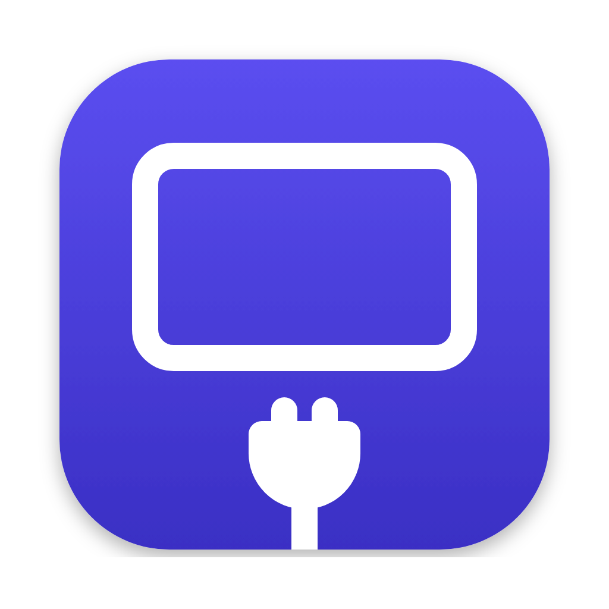

<p align="center">
  
</p>

<h1 align="center">Unplug</h1>

Soft-disconnect a display on macOS so the system no longer sees it, and plug it back in with one click. Unplug is a menu bar app with a matching command line tool, free and open source under the MIT license.

It's useful for a Thunderbolt or USB-C monitor you want macOS to ignore without pulling the cable, for example to keep charging and the monitor's USB hub while the screen is off.

## How it works

Apple has no public API that disconnects a display. Unplug makes one private call, `CGSConfigureDisplayEnabled`, which is exported by CoreGraphics (from SkyLight). It is the same mechanism other display tools use. On Apple Silicon with macOS 13 or later, a disabled display is torn down completely: it disappears from the display list and stops using GPU resources.

Everything else uses Apple's documented [Quartz Display Services](https://developer.apple.com/documentation/coregraphics/quartz-display-services):

- Every change runs inside a display configuration transaction (`CGBeginDisplayConfiguration` / `CGCompleteDisplayConfiguration`).
- Changes use session scope (`.forSession`), so logging out or restarting always brings every display back.
- The app listens for display changes with `CGDisplayRegisterReconfigurationCallback` instead of polling.
- Displays are tracked by UUID, because macOS can renumber display IDs.

A disconnected display drops out of every display list, so Unplug remembers the displays it disconnected in `~/Library/Application Support/Unplug/disconnected.json`. The app and the CLI share this file.

The private call lives in one file, [`Sources/UnplugCore/SkyLight.swift`](Sources/UnplugCore/SkyLight.swift), so it is easy to audit and to fix if Apple changes it. Because of it, Unplug can't ship on the Mac App Store.

### Keyboard backlight

When you disconnect a MacBook's built-in display, Unplug also turns the keyboard backlight off, and puts it back (including auto-brightness) when the display is reconnected. This uses the private `KeyboardBrightnessClient` class from CoreBrightness, isolated in [`KeyboardBacklight.swift`](Sources/UnplugCore/KeyboardBacklight.swift). You can also switch the keyboard light on and off by itself, with the "Keyboard Light" toggle in the built-in display section or `unplug keyboard on|off|toggle`. If you switched it off yourself, reconnecting the screen leaves it off.

To stop the keyboard light following the screen, untick "Turn Off Keyboard Light with Screen", or run:

```sh
defaults write io.github.mihaiflorinpopa.unplug keyboardBacklightFollowsBuiltin -bool false
```

### Keyboard shortcuts

These work anywhere while Unplug is running:

- Control-Option-Command-U (⌃⌥⌘U) reconnects every display Unplug disconnected.
- Control-Option-Command-B (⌃⌥⌘B) turns the built-in screen off or back on.

Untick "Keyboard Shortcuts" in the menu to turn them off.

### Safety

- Unplug refuses to disconnect the last active display unless you pass `--force`.
- By default, quitting the menu bar app reconnects every display it disconnected.
- If something goes wrong, press ⌃⌥⌘U, log out and back in, or run `unplug connect --all`.
- If you unplug a display while Unplug has it disconnected, it can't be reconnected. Unplug then offers "Forget" in the menu (or run `unplug forget <display>`). Plugging it back in brings it back either way.

## Install

Download `Unplug-<version>.dmg` from [Releases](../../releases), open it, and drag Unplug into Applications.

Unplug isn't notarized by Apple yet, so macOS blocks the first launch. To allow it:

1. Open Unplug once and dismiss the warning.
2. Go to System Settings > Privacy & Security, scroll down, and click "Open Anyway" next to the message about Unplug.
3. Confirm with your password.

Or remove the quarantine flag in Terminal instead:

```sh
xattr -dr com.apple.quarantine /Applications/Unplug.app
```

The command line tool comes inside the app; see [Command line](#command-line) to set it up.

### Build from source

```sh
./scripts/build-dmg.sh   # builds build/Unplug.app and build/Unplug-<version>.dmg
swift test               # runs the unit tests
```

### Versions and releases

The version lives in the [`VERSION`](VERSION) file and is stamped into the app, the CLI (`unplug --version`), the menu and the disk image name. The build number is the commit count.

To release, bump `VERSION` in a pull request. When it merges, CI tags `v<version>` and publishes a GitHub release with `Unplug-<version>.dmg` attached. Pushes to main that don't change the version don't create a release.

## Command line

The `unplug` command ships inside Unplug.app, so there's nothing extra to download.

### Set up

Link it onto your PATH once, after Unplug.app is in Applications:

```sh
sudo mkdir -p /usr/local/bin
sudo ln -sf /Applications/Unplug.app/Contents/Helpers/unplug /usr/local/bin/unplug
unplug --version
```

`/usr/local/bin` is on the PATH by default on macOS. If you'd rather not use `sudo`, link it into a folder in your home directory instead and add that folder to your PATH:

```sh
mkdir -p ~/.local/bin
ln -sf /Applications/Unplug.app/Contents/Helpers/unplug ~/.local/bin/unplug
echo 'export PATH="$HOME/.local/bin:$PATH"' >> ~/.zshrc   # then open a new terminal
```

The link points into the app, so updating Unplug.app updates the CLI too. To remove it, delete the link: `sudo rm /usr/local/bin/unplug`.

### Usage

```sh
unplug list                    # displays, including ones Unplug disconnected
unplug disconnect "LG"         # by part of the name, display ID, or UUID
unplug connect "LG"
unplug toggle 3
unplug connect --all
unplug forget "LG"             # stop remembering a disconnected display that was unplugged
unplug list --json
unplug keyboard off            # keyboard light: on, off, toggle, or no argument for its state
unplug --version
```

If a name matches more than one display, use its ID from `unplug list`. Unplug won't disconnect the last active display unless you add `--force`. The CLI and the menu bar app share their state, so you can disconnect a display from one and reconnect it from the other.

## Requirements

macOS 13 or later. Developed for Apple Silicon; Intel Macs are untested.

## Related projects

- [BetterDisplay](https://github.com/waydabber/BetterDisplay) and [Lunar](https://github.com/alin23/Lunar) both offer display disconnect, as closed-source or paid features.
- [blackoutd](https://github.com/toobuntu/blackoutd) uses the same call to turn off the built-in display automatically.
- [DisableMonitor](https://github.com/Eun/DisableMonitor) did this for older macOS versions and is archived.
